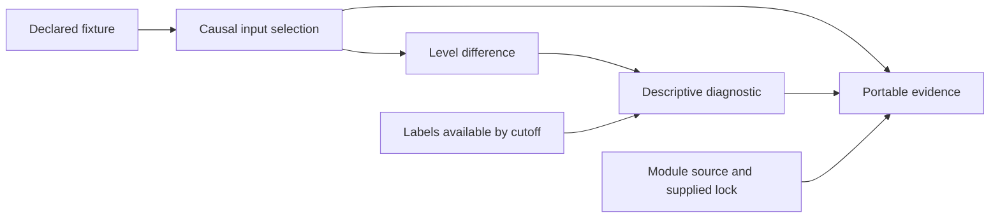

# Understand the platform architecture

This page distinguishes the implemented repository from the proposed platform. Return to [project state](project-state.md) for the navigation index. See [decisions](decisions.md) for reasons, [open questions](open-questions.md) for missing integration facts, and [to dos](todos.md) for sequencing.

## What exists in this revision

The [master-plan source basis](master-plan.md#source-basis) describes the archived ChatGPT discussions and report. They are source material rather than inspected framework implementations, and this public copy leaves them out.

The vendored [pstack source](../.agents/pstack-source.json) supplies the project's agent workflows. [Codex model settings](../.agents/pstack-models.md) and [Claude model settings](../.claude/rules/pstack-models.md) are project-local. [AGENTS.md](../AGENTS.md) directs agents to poteto mode and the living project record. A `SessionStart` hook in the [project Claude settings](../.claude/settings.json) repeats the poteto mode instruction at the start of every Claude Code session.

The repository foundation is implemented in [tools/repo.py](../tools/repo.py), its [pytest shard plugin](../tools/shards.py), and the [Makefile](../Makefile). It provides disposable Git snapshots, dependency preparation, offline verification, installed Git hooks, and guarded PR creation.

[quant_research.packages](../src/quant_research/packages.py) implements portable development records. Its two operations save a complete revision and open a verified revision. [The CLI](../src/quant_research/__main__.py) inspects or verifies one. [Package comparison](../src/quant_research/compare.py) verifies two packages and prints the differences between their selected trials, as [D034](decisions.md#d034-compare-the-selected-trials-of-two-verified-packages) describes. [The Python example](../examples/save_development.py) and its [saved package](../examples/development-package/manifest.json) demonstrate authoring without a research computation. [Causal replay](../src/quant_research/replay.py) runs a fixed synthetic fixture and saves its evidence as a package. [Replay the synthetic development fixture](#replay-the-synthetic-development-fixture) describes it.

[quant_research.records](../src/quant_research/records.py) holds the canonical JSON encoding and reader, the duplicate-key JSON hook, the write-once file helper and shared content-addressed writer ([D077](decisions.md#d077-align-recovery-records-and-pinned-lesson-authority)), the numbered-file log reader and appender that the resource ledger store, the capability exposure ledger, the call log, and the review store share, the record field parsers, and `PackageError`, which packages and the other record modules share. [D033](decisions.md#d033-share-record-helpers-through-a-public-records-module) records why the error class moved with them.

[quant_research.capability](../src/quant_research/capability.py) runs frozen held-out comparisons and reusable development definitions through one exposure ledger. A procedure receives only copied task inputs. A separate committed answer key scores every repeat at disclosure.

Development executions record exposure before dispatch and use fresh identities, so reruns retain one task-set version and directory without restoring held-out eligibility. `ResearchProcedure` wraps an actual archived loop for one supplied candidate. The ledger keeps historical schema 1 comparison identities and adds development events. The pilot baseline and limits are recorded in [D069](decisions.md#d069-record-a-reusable-development-baseline-through-the-research-loop). Independent held-out tasks and registry import remain open under [D011](decisions.md#d011-seal-capability-evaluation-answers-and-retire-disclosed-tasks).

[quant_research.model_provenance](../src/quant_research/model_provenance.py) records model provenance as data. A model record names its provider, model, version, and knowledge cutoff, and keeps unknown values explicit. Each change to a campaign's role assignments, fallbacks, or model versions creates a role version linked to the version it replaces, and a version that campaign resolution builds links none, because the revision chain records the change. An active version may name only a provider in `ACCEPTED`, the routes whose live check recorded a go, and `MODELS` holds the records that campaign roles name. A cutoff check classifies a historical evaluation period against one model's cutoff and supplies the qualifying sentence for a report. The module calls no provider. [D012](decisions.md#d012-record-model-provenance-and-role-versions-as-inactive-data) records the shape and its limits.

[quant_research.campaigns](../src/quant_research/campaigns.py) implements versioned campaign specifications. `start_campaign` and `revise` return immutable revisions. `save_revision` writes one canonical JSON file per revision, and `open_campaign` validates a campaign directory's complete revision history. Each revision carries forward the trial references and exposure events that earlier revisions on any branch recorded. A revision that sets a model-call, wall-time, or token limit is stored under schema version 2, and every other revision keeps its version 1 bytes and ID, per [D056](decisions.md#d056-make-the-workflow-the-single-accounting-owner-with-durable-call-receipts). [D013](decisions.md#d013-version-campaign-specifications-as-content-addressed-revisions) records the rules and limits. The campaign runner reads one revision, and `campaign start` and `campaign steer` read revision files ([D076](decisions.md#d076-drive-the-research-loop-from-the-cli-and-reconcile-its-receipts-in-status)). `resolve` turns a revision and an operator `Setup` into an `Authority`. It holds a run context scoped to the permitted datasets, the corpus of the revision's pinned sources, the active role version and its providers' policies, each active role's prompt, and a `Toolset` bound to that context narrowed to the search cutoff. It loads the frozen rules file that the revision's evaluation digest names from `Setup.rules`, and `Authority.search` holds the narrowed context, the rules, and the campaign's package directory ([D065](decisions.md#d065-run-experiments-inside-the-loop-under-a-frozen-search-method)). `register` and `contract_sources` produce the pinned sources ([D062](decisions.md#d062-resolve-a-campaign-revision-into-its-run-authority)).

[quant_research.steering](../src/quant_research/steering.py) records pause, resume, cancel, annotate, and steer events in one append-only log per campaign. Folding the log gives the campaign's control state, which is running, paused, or cancelled. A steer links a revision to the child that `campaigns.revise` created, so a methodology change keeps its parent's trials and its parent's line. `log_bytes` and `read_log` round-trip the log as canonical JSON, and reading checks each steer against the opened campaign. The campaign runner and the research loop enforce the log, and nothing persists it yet. An event may declare the restrictions of its text, stored only when declared so earlier logs keep their bytes, and `declared` returns only those events ([D063](decisions.md#d063-run-the-platform-owned-research-loop-as-one-temporal-workflow-per-campaign)). [D031](decisions.md#d031-record-campaign-steering-in-an-append-only-log) records the rules.

[quant_research.splits](../src/quant_research/splits.py) divides an index of decision times into expanding walk-forward folds. Each fold withholds the training samples whose labels reach its evaluation window, plus a configured embargo. A preprocessing fit reads only its fold's training rows, and a label check rejects labels that depend on observations past their declared horizon. The module owns evaluation windows and fitting discipline, not replay timing or evaluation statistics. [D014](decisions.md#d014-fit-and-label-within-walk-forward-windows) records the choices and limits.

[quant_research.evaluation](../src/quant_research/evaluation.py) implements the pilot evaluation profile. `evaluate` takes a return series, an optional baseline on the same periods, and a package record. It returns a verdict with its intervals and subperiod estimates, or an invalid-input reason, and either result carries the procedure version and the declared parameters. It reads only the record's trial count, for the selection adjustment. It does not read artifacts, build portfolios, or simulate execution. [D015](decisions.md#d015-evaluate-pilot-signals-against-their-recorded-trials) records the procedure and its assumptions.

[quant_research.accounting](../src/quant_research/accounting.py) records resource use per campaign, trial, run, and attempt in an append-only ledger. It admits each attempt only when its estimate fits every declared limit, counts each failed or open attempt against one of its run's failure slots, and reports exact `Decimal` spend by campaign, role, and outcome. Usage may name tokens or cost as unreported, with the reported amount as a lower bound. The campaign runner keeps the only ledger in its workflow state, and `dump_ledger` exports it as canonical JSON that `load_ledger` replays through the same checks. [D016](decisions.md#d016-account-for-resources-in-an-append-only-ledger) records the rules, and [D056](decisions.md#d056-make-the-workflow-the-single-accounting-owner-with-durable-call-receipts) records the single owner and unreported usage.

[quant_research.workflows](../src/quant_research/workflows.py) defines versioned research workflow templates for Phase 6. A template declares roles, tools, step dependencies, branch and iteration limits, shared resources, evidence exchanges, and human checkpoints. `validate` rejects an inconsistent template with a reason, `revise` creates a new version linked to the previous template ID, and `differences` lists the declared fields that differ. The module holds a single-branch baseline and four initial multi-branch patterns. Nothing executes a template yet. [D017](decisions.md#d017-define-research-workflows-as-validated-versioned-templates) records the semantics and limits.

[quant_research.sources](../src/quant_research/sources.py) registers source documents in a local file store and publishes versioned generations of located text chunks. Blobs, source occurrences, extraction and chunk generations, and publications have separate identities, as the [SurrealDB plan](surrealdb-plan.md#5-ingestion-identity-and-publication) requires. Readers pass a trusted run context and see only complete generations whose source occurrence that context may read. [D018](decisions.md#d018-publish-complete-source-generations-from-a-file-store) records the identities and limits, and [D036](decisions.md#d036-filter-source-reads-through-the-trusted-run-context) records the read filter. The later SurrealDB registry imports these records.

[quant_research.locators](../src/quant_research/locators.py) finds equations, tables, figures, and claim sentences in a published extraction and publishes them as versioned locator generations in the same file store. Each location has a kind, an exact code-point span, and its text, and `LocatorGeneration.ref` names it within the generation. `LocatorGeneration.lookup` resolves a ref without scanning the locations. A new locator version publishes a new generation, and readers see only generations whose source occurrence the run context may read. The markdown locator's rules are fixed per version. Version 2 reads more Markdown forms than version 1, and neither parses PDFs. [D043](decisions.md#d043-locate-paper-elements-in-published-extractions) records the rules and limits.

[quant_research.retrieval](../src/quant_research/retrieval.py) is the exact eligible-corpus baseline for Phase 3 retrieval. `publish_corpus` pins a set of published generations as a corpus, and a run context's `generation` names that corpus. `corpus_members` reads through the source filter and lists the pinned corpus's readable generations, and `eligible_units` keeps their chunks. `retrieve` answers an exact identifier query or a BM25 lexical query over all of them, and `eligible_restrictions` lists the source restrictions of the members those units come from. Each result records the query, context identity, corpus, cutoff, and supplied units, round-trips through canonical JSON, and replays to the same units or raises. [D040](decisions.md#d040-retrieve-exactly-over-a-pinned-eligible-corpus) records the rules and limits. No database, embedding, or vector search exists yet.

[quant_research.findings](../src/quant_research/findings.py) implements the storage-free review lifecycle for claims, findings, and lessons. A `Ledger` holds an append-only tuple of proposal, review, supersession, and declaration events and derives each record's status and the eligible lessons from it. `Ledger.as_of` answers the same questions for an earlier time. Records cite other ledger records or opaque external evidence IDs. Record IDs and the log's chained head reuse the canonical JSON encoding of [quant_research.records](../src/quant_research/records.py). `event_value` and `parse_event` convert one event to and from that encoding for storage, and the module imports no database or source code. Declarations give external evidence its restrictions, each record derives restrictions from what it cites, and `admissible_lessons` keeps the eligible lessons a run context may read at its memory pin. Admission and the restrictions returned to tools come from one operation over that exact prefix ([D077](decisions.md#d077-align-recovery-records-and-pinned-lesson-authority)). [D019](decisions.md#d019-admit-lessons-only-through-recorded-review-events) records the rules and limits.

[quant_research.invalidation](../src/quant_research/invalidation.py) traces one corrected or revoked dataset vintage, invalid experiment package, or retracted source to the claims, findings, and lessons whose supporting links reach it. A vintage reaches records through the packages whose trials declare it as an input. `assess` returns a report of each affected record and whether independent support remains, and it replays the earlier invalidations still in force so that withdrawals add up. The report round-trips through canonical JSON. `suspend` appends a review event that suspends each record left without support, and re-review restores a suspended record. `catch_up` replays every invalidation in force against a ledger that has moved on. [D046](decisions.md#d046-suspend-records-whose-support-an-invalidation-removes) records the rules and limits.

[quant_research.reproduction](../src/quant_research/reproduction.py) records paper reproduction specifications on synthetic material. Each implementation choice and reported target cites source locators or names an open question. Freezing fixes the comparison basis and tolerances under a canonical identity before any result. Classification returns a verdict per target for matched inputs or adapted data. An open question, a missing value, or a non-finite value makes that verdict inconclusive. A specification can pin a published locator generation. Freezing it then resolves every equation, table, figure, and claim ref through the caller's run context and refuses one that is unknown, of the wrong kind, or unreadable. The reproduction holds the pinned generation and repeats the ref check on every construction, including a direct build or a copy. Passage and code refs stay opaque, and the module does not read papers or run computations. [D020](decisions.md#d020-fix-the-reproduction-comparison-before-results) records the rules.

[quant_research.probit](../src/quant_research/probit.py) fits probit models and holds the paper case's reproduction. `fit` estimates by maximum likelihood with Newton's method and returns the coefficients, a Bartlett-weighted Newey-West covariance, both log-likelihoods, and Estrella's pseudo R². `SPECIFICATION` is the frozen specification of Table 2's SPREAD row, and `observe` fits its eight horizons on the approved series in a data root. [D071](decisions.md#d071-reproduce-table-2s-spread-probit-on-adapted-fred-data) records the choices and the live run.

[quant_research.code_index](../src/quant_research/code_index.py) indexes the Python code of one Git commit. `index_commit` reads the commit's tree and blobs from Git objects and parses them without checkout or execution. Its canonical JSON lists modules, classes and functions with line spans, the import graph, test references, declared dependencies, and per-file parse failures, all pinned to the commit. [D022](decisions.md#d022-index-code-from-git-objects-at-a-pinned-commit) records the resolution rules and limits.

[The pilot data catalog](../src/quant_research/catalog.py) records datasets as an append-only log of documented, validated, approved, and revoked transitions. Documentation names the owner, fields, plain access labels, the dataset's vintage, providers approved to receive it, known gaps, and digest references to vintage evidence for publication, revision, and arrival times. A missing vintage aspect is a gap that blocks approval. Approval follows manual validation and names a timing-and-access adapter that the catalog does not run. A revoked approval stays in history and exposes no adapter. Search matches the name, owner, and fields, filters by status, and orders by name. [D024](decisions.md#d024-catalog-datasets-as-a-log-of-evidenced-transitions) records its evidence limits, and [D052](decisions.md#d052-ingest-the-pilots-public-data-into-a-vintage-addressed-store) adds the vintage and provider approvals.

[quant_research.datasets](../src/quant_research/datasets.py) is the timing-and-access adapter that catalog approval names. `read` serves a dataset only while the run context's scope permits it and clears its documented access labels, and the catalog's latest event approves it through this adapter. A dataset the run cannot see is refused as a name that does not exist before any status is checked, and every refusal comes before any file opens. It then opens `<dataset>/<vintage>.json` for the vintage that the documentation in force names and supplies each key's highest revision available by the context's cutoff, with a record of the vintage, catalog digest, cutoff, context identity, and supplied rows, and the documentation's labels and provider approvals. `save` stores a dataset file under its vintage and keeps every earlier one. `ReadRecord.replay` returns the same rows from the same file bytes. Mapped campaign contexts also enforce their pinned month-label interval unions at this boundary, and new archives preserve the actual supplied read records ([D081](decisions.md#d081-enforce-permitted-months-through-pinned-dataset-contracts)). `read` parses each stored vintage once per process, checks the file's SHA-256 on every read, and supplies rows whose values are read-only ([D065](decisions.md#d065-run-experiments-inside-the-loop-under-a-frozen-search-method)). `listing` and `describe` pass the same gate, and `publish_contract` publishes each part of a dataset's contract as its own source occurrence under the dataset's approvals ([D062](decisions.md#d062-resolve-a-campaign-revision-into-its-run-authority)). [D045](decisions.md#d045-read-approved-datasets-through-a-timing-and-access-adapter) records the rules and limits.

[quant_research.signals](../src/quant_research/signals.py) defines signal programs as typed operators, `Series`, `Lag`, `TrailingMean`, `TrailingMin`, `Subtract`, `Ratio`, `Threshold`, `Not`, `And`, and `Or`. `SAHM` is the real-time Sahm indicator, and `SAHM_RULE` is its 0.50 threshold. `decide` evaluates a program once per decision month. It narrows the run context to the end of the previous month, reads each dataset through the dataset adapter, and keeps the latest computable month, its value, the vintage's availability time, and the adapter's read records. [D053](decisions.md#d053-evaluate-signal-programs-per-decision-and-reconcile-the-sahm-series-with-fred) records the missing-month convention and the limits.

A `Series` at vintage k reads the vintage the decision k months earlier read, so `decide` makes one adapter read per dataset and vintage. Constructors check each parameter's range and each program's size. `parse` turns an untrusted JSON program into a program or a `Rejected` value that names one reason, and it accepts only datasets in the search universe, `public_data.SEARCH_UNIVERSE`, that the catalog approves. `canonical` and `digest` give a program's canonical JSON and its SHA-256. [D064](decisions.md#d064-search-signal-programs-in-a-bounded-grammar-over-a-chosen-alfred-universe) records the ranges, the size limit, the leak rejections, and the universe.

[quant_research.backtest](../src/quant_research/backtest.py) computes an allocation's monthly returns. `read` reads `french.ff3_monthly` through the dataset adapter and converts percent text to exact `Fraction` values. `Market.sample` pairs an allocation keyed by month with those factors. A `Sample` holds consecutive months, each with a `Holding` of market or T-bills. An engine maps a `Sample` to one return per month. `plain` computes `RF + w × (Mkt-RF)` and the switch costs in `Fraction` and is the reference. `vectorbt` runs vectorbt 1.2.0 and imports it only when called. `compare` runs `plain` and another engine and reports their largest monthly difference against `TOLERANCE`. [D054](decisions.md#d054-backtest-allocations-with-a-plain-reference-and-a-vectorbt-engine) records the cost convention, the vectorbt layout, and the tolerance.

[quant_research.worker](../src/quant_research/worker.py) runs generated Python over an approved dataset slice in a Docker container. It reads the slice through the dataset adapter, mounts the slice and the source read-only, and runs the [pinned image](../worker/Dockerfile), which adds hash-locked numpy and pandas, without network, host environment, or capabilities. The container runs as a non-root user on a read-only root with tmpfs scratch and pids, memory, CPU, and wall-clock limits. Only a signal file that passes host validation returns, with a record of the image ID, source digest, read record, and limits. A `RunLog` keeps each container run's record, outcome, and output digest as numbered canonical JSON files. The campaign runner calls the worker through `execution.generated` when the campaign specification enables generated code, and appends each container run to the operator's `RunLog`. The `run_signal` agent tool does the same when the operator binds a run log to its toolset. [D047](decisions.md#d047-run-generated-signal-code-in-a-locked-down-container) records the rules and limits.

[quant_research.access](../src/quant_research/access.py) defines restriction labels and trusted run contexts. Material carries labels, provider approvals, and an availability time, and derived material inherits the most restrictive combination. A run context answers whether the run may read an item or send it to a named provider, and names each denial. Contexts come from one trusted constructor or by narrowing the cutoff, and no context can clear confirmation material. A context may carry a dataset scope, which the identity includes only when it is set ([D062](decisions.md#d062-resolve-a-campaign-revision-into-its-run-authority)). Source reads and the dataset adapter use its read check, [retrieval](decisions.md#d040-retrieve-exactly-over-a-pinned-eligible-corpus) and agent tools read through them, and provider calls use its send check. [D025](decisions.md#d025-carry-restrictions-with-material-and-authority-with-the-run) records the rules.

[quant_research.providers](../src/quant_research/providers.py) is the outbound boundary to model providers. A gateway routes each provider to its adapter and its versioned data policy. Before any adapter runs, it applies the run context's send check and the policy's label ceiling, and it tries a role's fallbacks under the same check. It parses structured output exactly and returns a reply with the restrictions of its inputs. It sends model i of a chain only under call ID i of a lease that the campaign workflow minted and reserved. It claims each ID in a local call log before the adapter runs and stores the outcome, usage, runtime, resolved model, and fixed-token failure reason after. Schema 4 reads version 3 entries and historical activity results without rewriting them ([D077](decisions.md#d077-align-recovery-records-and-pinned-lesson-authority)). It keeps the sent request and the reply as content-addressed transcripts beside the log, so a later holder of the lease reuses a stored reply, seals a claim without a reply as `unknown`, and never sends one ID twice. A usage cap is recorded as `rate_limited`, and the chain moves to the next fallback. `close` ends a lease and returns its receipts, which the workflow charges. The gateway writes no ledger. `ScriptedProvider` is a deterministic local fake. [D041](decisions.md#d041-check-outbound-provider-content-against-the-run-and-a-versioned-provider-policy) records the policy rules, and [D056](decisions.md#d056-make-the-workflow-the-single-accounting-owner-with-durable-call-receipts) records the leases and receipts, and [D061](decisions.md#d061-run-model-calls-and-tool-calls-as-activities-that-stop-their-adapters) records the transcripts and provenance.
[quant_research.claude_adapter](../src/quant_research/claude_adapter.py) is the first real adapter. It calls the installed Claude Code CLI as a tool-disabled completion, as D051 selects. Each call checks `claude auth status`, then runs one stream-json session in an empty directory and in its own process group. The session gets an allowlisted environment and runs with every tool, slash command, MCP server, and settings source off. Its first turn, `/cost`, is answered by the CLI itself and makes the CLI report its inventory. The adapter writes the request only when that inventory equals the expected one, and it maps the CLI's events to the gateway's replies. [D057](decisions.md#d057-call-claude-code-as-a-tool-disabled-completion-behind-a-local-first-turn-gate) records the flags, the probes, and the limits.

[quant_research.codex_adapter](../src/quant_research/codex_adapter.py) is the second real adapter. It sends one tool-free turn to a fresh Codex 0.162.1 app-server under the researcher's ChatGPT sign-in. Each call runs in a temporary Codex home that holds only a link to the sign-in file, and the adapter refuses to send when a check shows any tool, MCP server, or instruction file. [D058](decisions.md#d058-call-codex-through-a-fresh-app-server-in-an-isolated-home) records the checks, the live check, and the limits.

[quant_research.activities](../src/quant_research/activities.py) runs gateway and tool calls as Temporal activities. A worker registers the `model`, `tool`, and `close` activities with its gateway and a resolver from a campaign revision to its `Authority`, whose context authorizes each send and whose `Toolset` runs each tool call ([D065](decisions.md#d065-run-experiments-inside-the-loop-under-a-frozen-search-method)). Workflow code calls `ask_model`, which runs one model attempt from its lease to its close and returns the result, the receipts, and the elapsed time for the caller to charge, and `call_tool`, which returns a tool call's material. The model activity runs the gateway on a thread, heartbeats, and sets the adapter's cancel event on a workflow cancel or one grace period before its own deadline. A failure crosses Temporal as a fixed error with no backing text. Both worker types inherit one decorated `close` implementation ([D077](decisions.md#d077-align-recovery-records-and-pinned-lesson-authority)). The research loop calls them. [D061](decisions.md#d061-run-model-calls-and-tool-calls-as-activities-that-stop-their-adapters) records the rules and limits.

[quant_research.research](../src/quant_research/research.py) runs the platform-owned research loop. `start` runs one campaign revision as one `ResearchLoop` workflow, whose ID is the campaign ID and whose memo pins the revision and its evaluation rules digest. Its own `opening` activity resolves each revision once and returns the role prompt, the assignment, the authority digest, a floor for declared notes, and the protocol as text, so replay reads them from history. Each step calls `ask_model` with the prompt, the protocol, and the revision's step entries, parses the reply into a tool call, an experiment request, a conclusion, or a stop, and runs a tool call with `call_tool` under the revision its ask ran under. Its `experiment` activity calls `reference.extend`, which runs the program on the rules file's search window and saves the next head of the campaign's lineage package, and `forfeit` appends a failed experiment as a failed trial. The workflow keeps only the head's digest, and `record` reports it ([D065](decisions.md#d065-run-experiments-inside-the-loop-under-a-frozen-search-method)). Each ordinary ask is a ledger attempt on one shared run. Separate reservations hold a closing shortlist ask and fresh conclusion and critique completions. A refusal, 100 ordinary asks, or 32 MiB of history closes the search through the reserved ask and keeps its outcome inconclusive. An accepted shortlist freezes its revision, package head, and trial IDs before one held-back evaluation activity. The loop then asks its proposing provider for a trial-citing conclusion and another authorized provider for a critique, with a fresh same-provider completion when no other provider is active. [D066](decisions.md#d066-interpret-held-back-results-with-a-separate-critique) records the protocol, evidence classification, and retained assessment. `control` and `steer` are updates whose validators refuse what the log or the loop would refuse, and the workflow dates every event. `status` reads a running or closed loop, and `record` reads a closed one with both logs in parts. `worker` serves the loop on a queue of its own, and the `campaign` commands drive it, as [Drive a research campaign](#drive-a-research-campaign) describes. [D063](decisions.md#d063-run-the-platform-owned-research-loop-as-one-temporal-workflow-per-campaign) records the rules and limits.

[quant_research.agent_tools](../src/quant_research/agent_tools.py) exposes evidence and the isolated worker to a model as seven typed tools, `search_corpus`, `list_datasets`, `describe_dataset`, `read_dataset`, `lookup_location`, `read_lessons`, and `run_signal`. A `Toolset` binds one trusted run context, the source store, the dataset store, the catalog, and the review log at creation. A run that enables generated code also binds a run log, a signal directory, and container limits. A model supplies only a tool name and JSON argument text, which the module parses against the tool's JSON Schema before any read. Each call returns the backing module's result or a refusal with a fixed message, and its canonical record replays byte-identically under the same context. A container run's record replays against its run log without a second run. `Call.material` renders a call as the gateway's `Material`, whose restrictions derive over every readable item the tool read and over a floor approved for the run's providers ([D059](decisions.md#d059-render-each-tool-call-as-gateway-material-under-the-restrictions-of-what-it-read)). Campaign resolution builds the `Toolset` of a campaign run ([D062](decisions.md#d062-resolve-a-campaign-revision-into-its-run-authority)). The `tool` activity runs them, and the research loop schedules it. [D049](decisions.md#d049-expose-evidence-to-agents-through-typed-tools-bound-to-the-run-context) records the schema, refusal, and record rules.


[quant_research.store](../src/quant_research/store.py) configures a local SurrealDB 3.3.4 server and the Python 2.0.0 client for storage qualification. It builds a loopback RocksDB start command and the CLI export and import commands, connects over WebSocket, and runs queries that raise every failed statement. [The probe suite](../tests/test_store.py) starts a real server with temporary storage and checks decoding, errors, identities, time, optional values, decimals, transactions, uniqueness, backup and restore, and filtered vector search. It also checks table and field permissions, record access, and namespace and database users. [D027](decisions.md#d027-qualify-the-pinned-surrealdb-server-and-client-over-websocket) and [D038](decisions.md#d038-restrict-reads-through-record-access-and-make-denied-writes-throw) record the observed semantics. No source ingestion or retrieval uses SurrealDB yet.

[quant_research.registry](../src/quant_research/registry.py) imports a verified package into SurrealDB and a local content-addressed object store that stands in for S3, and exports it again. The object store keeps the original manifest and artifact bytes once per digest. SurrealDB keeps one row per object, specification, trial, attempt, exposure, and package, keyed by the identity the package carries. A package row names a selected trial only when the package has one, and import makes that field optional in a database created before [D060](decisions.md#d060-let-a-package-record-no-selected-trial). Import compares existing rows inside one transaction, refuses a conflicting identity, and retries a commit conflict, so repeated and concurrent imports converge on one copy. Export writes the stored bytes back and opens them with `open_package`. `remove_unreferenced_objects` removes object files that no row names, and waits on a lock that each import holds until its rows commit. `import_invalidation` stores D046 invalidations, and `import_ledger` stores the D019 review log one row per log position, in the same kind of transaction. `import_run_log` stores a D047 run log the same way, with each entry's exact bytes and run ID, and `load_run_log` returns those bytes in log order. `load_ledger` folds the stored log, replays every stored invalidation against it, and stores the suspensions it appends. [D039](decisions.md#d039-register-verified-packages-in-surrealdb-and-keep-their-original-bytes-in-an-object-store) records the shape and limits.

[quant_research.acceptance](../src/quant_research/acceptance.py) records result acceptance for each logical execution, which is one package run. An append-only, in-memory log holds attempt submissions, completions, and acceptances, and folds them into per-run state that shows every attempt and at most one accepted attempt. A successful attempt stays unaccepted until an `Accepted` event names it with an actor and a reason, and a later acceptance must name the attempt it supersedes. The log round-trips through canonical JSON bytes and has no store. [D030](decisions.md#d030-accept-results-through-explicit-events) records the rules.

## Boundaries for the initial local workflow

Repository verification owns Git capture, dependency matching, test execution, hooks, and PR creation checks. Research package storage owns canonical records, artifact bytes and hashes, and known trial and exposure history. Fixture replay owns the declared synthetic data timing and numerical behavior. A CLI should parse arguments and display results without duplicating those policies.

One authored runner has two execution owners. Its installed copy in Git's common metadata directory owns effective-index capture, raw export, PR publication, and merges. Each captured snapshot's runner owns dependency policy, environment matching, and suite execution under that snapshot's exact Python pin. The installed copy never substitutes its own dependency policy for another captured commit. A fixed private subprocess contract transfers the captured identity and environment receipt between them. The required captured tools package marker prevents a dependency's regular package from replacing its namespace. Verification loads pytest, and coverage when selected, from prepared dependencies before adding captured root and source paths. Those paths precede dependencies for ordinary application imports; packages already loaded with the verification tools remain bound to their prepared versions. Child commands discard inherited Python, pytest, uv, Git, and coverage settings that could select a different source or configuration, retaining the supported offline and uv-cache inputs.

Capture a tree or commit once. Copy the effective index before `write-tree` and export physical Git objects, ignoring replacement refs, archive attributes, and checkout filters. Commit, tree, subtree, and blob replacements do not change the captured or exported bytes. Validate symlink components and portable path identities from the complete Git-entry table before writing them. Preserve confined internal and dangling links, raw targets, and executable modes. Reject external traversal, case or canonical-Unicode path collisions, and differently spelled known link targets. Prepared dependency environments have separate permanent-path generations. Fresh locked preparation validates distribution metadata, supplied RECORD hashes and sizes, runtime identity, and offline lock synchronization. It then fingerprints the complete generation and atomically publishes a versioned pointer. Reuse compares that independent fingerprint before executing the prepared interpreter or tools, then checks runtime identity and offline synchronization. No check repairs or reseals a generation. A worker with the new policy requires explicit preparation for an unsealed receipt; older captured workers retain their own policy and the `repo-snapshot-v1` contract.

The commit hook runs the smoke suite on the staged tree, the merge-commit hook runs it on a merge result, and the rewrite hook runs it on HEAD after a rebase. Git ignores the rewrite hook's exit status, so it reports a failure without undoing the rebase. Pushes run no suite. `make merge PR=<n>` runs the full suite once per merge, on the exact commit that lands, under a lock in the Git common directory. It merges newer base commits in first, runs the smoke suite instead when the diff touches only documentation, posts the `Passed` line, and merges with `--match-head-commit` ([D074](decisions.md#d074-run-the-full-suite-only-inside-make-merge)). A Claude Code hook blocks Claude sessions from calling `gh pr merge`, `make verify`, and `make coverage` directly. The PR wrapper rejects invalid titles, including NUL characters, before GitHub lookups. After metadata checks, it pushes the literal captured object ID to the captured, validated push URL, and runs no suite. Changing the named remote's push URL after lookup cannot redirect that operation. GitHub operations explicitly target github.com, matching the accepted destination. Before pushing, the PR wrapper requires available, complete local history and at least one head commit beyond the resolved base commit. That query ignores replacement refs and legacy grafts, disables lazy fetch, and rejects shallow history without fetching. Duplicate lookup reads every page for the requested base and qualified head, then matches both branch names and the full head repository identity. Creation runs once. The wrapper verifies the canonical PR URL, repository, head branch, captured head commit, and requested base before separate self-assignment. If creation returns no usable URL, one paginated lookup can recover an exact matching identity. Failed or ambiguous recovery reports an unknown outcome. A failed creation or assignment step preserves the known URL and verification evidence without returning success or creating again. Installed Git hooks ignore ordinary unstaged edits to the runner and Makefile. Website/API actions and bypassed or uninstalled hooks can skip local enforcement. [D005](decisions.md#d005-verify-disposable-snapshots-with-prepared-dependencies), [D007](decisions.md#d007-install-the-git-boundary-and-execute-the-selected-snapshots-policy), and [D008](decisions.md#d008-seal-fresh-generations-and-reconcile-publication) record the reasons and costs.

The generation fingerprint includes every relative path, entry kind, regular-file size and bytes, file and directory mode, and raw symlink target. It includes empty directories and unrecorded files. Internal and dangling links must remain confined to the generation. External links are supported only for the standard venv Python aliases that resolve to the selected runtime executable; its resolved path, bytes, and mode enter the fingerprint. Special files and unsupported links fail before publication. Hardlinks count by visible path and bytes, so fixtures replace shared installed files atomically.

The initial locked uv installation and selected runtime remain trusted. The fingerprint observes the external interpreter executable, but does not authenticate its provenance, external standard library, or system libraries. Timestamps, inode identity, owners, ACLs, and extended attributes are outside the POSIX profile. It does not protect against an owner changing both the receipt and installation, or a hostile writer racing verification and execution. A mismatch reports the generation path and expected and observed digests; it cannot identify which entry changed.

The runner supports POSIX environments, exact Python patch pins, and dependency-only environments without an installed application. The strict source profile permits registry dependencies and the root virtual entry. Direct archive, Git, local, editable, workspace, mixed, and unknown sources are rejected. The uv project remains virtual; wheel verification invokes its locked Hatchling backend directly. Tests use real wheels through a local file-based package index, so dependency changes can be checked without network access. Coverage and wheel fixtures add their own dependencies and regenerate their locks through the shared fixture helper; generic fixtures retain both pinned runtime paths. Missing or mismatched preparation stops a check and prints the target-specific `make deps` command.

Run `make setup TARGET=index` after staging dependency files. It installs the runner and hooks before preparing their environment. After installation, `make deps TARGET=REF` prepares a selected snapshot and `make hooks TARGET=index` explicitly refreshes the installed mechanism. Checks never install or refresh it. Reinstall after moving or copying a repository. The fixed bootstrap must parse the installed runner, and snapshots without the private worker contract fail instead of borrowing another runner. Explicit setup uses its active installer; a manual Make invocation still requires its Makefile to parse.

Installation stages and compiles privately, then takes a persistent common-directory advisory lock before reading backups. Publication, Git configuration, and rollback hold that same lock across linked worktrees. This serializes installers. Hooks and Make commands do not acquire it, so refresh does not promise a coherent bundle to concurrent readers or recovery after process termination. Local POSIX filesystems are the supported profile; Windows and network-filesystem lock semantics remain unverified.

Use `make smoke-index` for the staged tree and `make merge PR=<n>` to verify and land a PR. Outside Claude Code, `make verify TARGET=REF` and `make coverage TARGET=REF` still run the full and coverage suites by hand. Every suite runs all of its steps to the end, then prints one summary of the failed steps. The steps are ruff check, ruff format, pytest, and, for the full and coverage suites, the wheel check. Each full-suite shard reports a failing test as soon as it fails. The full suite collects its tests once and runs them in four pytest shards; smoke and coverage run in one process ([D044](decisions.md#d044-shard-the-full-suite-and-keep-the-smoke-suite-small)). The full and smoke suites skip `tests/test_repo_gates.py` when an earlier full suite on this machine passed the same gate inputs, and they print that skip just before their `Passed` line ([D072](decisions.md#d072-skip-gate-tests-whose-exact-inputs-already-passed)). The full and coverage suites also need the `surreal-db` executable from `brew install surrealdb/tap/surreal-db` and the pinned Temporal CLI; the smoke suite needs neither.

Full and coverage verification build an application wheel offline, then import it from a fresh directory without source paths or installation. The wheel consumer opens, reads, and copies the example package, and replays a small fixture it writes itself. Full and coverage verification then run the inspect and verify commands from the wheel. Ordinary development uses `make run ARGS='inspect examples/development-package'`, `make run ARGS='verify examples/development-package'`, or `make run ARGS='compare PACKAGE_A PACKAGE_B'`. These commands select dependencies from one captured index and execute working source. Stage and prepare dependency changes before using them. `make example DESTINATION=/tmp/quant-example` uses that same captured lock when recording its environment. It creates fresh trial, run, and attempt identities and observes its authoring time.

Wheel verification does not establish source-distribution contents. Source-distribution file selection and publication are outside the implemented workflow; [D009](decisions.md#d009-verify-the-built-application-without-installing-it) records that limit.

Preparation retains every permanent environment generation, including failed or superseded preparations. [D005](decisions.md#d005-verify-disposable-snapshots-with-prepared-dependencies) gives the manual cleanup conditions across linked worktrees. Raw export buffers the tracked tree in memory. Large binary data and a streaming export redesign are outside this initial repository workflow.

Keep scientific trial, deliberate run, and execution attempt identities distinct. A retry must preserve prior attempts. Related research must retain supplied exposure history. A portable local package cannot establish that an operator disclosed every historical exposure or that confirmation data remains untouched.

Packages are self-contained directory revisions with a canonical versioned manifest, its checksum, and hashed artifact bytes. A package selects one trial or none ([D060](decisions.md#d060-let-a-package-record-no-selected-trial)) and retains supplied trials and exposure events. Each trial has a stable lineage ID, a specification, links to supplied prior trials, and execution attempts. Repeats use new run IDs; retries retain their run and predecessor attempt. Generic outcomes name result artifacts without interpreting their scientific meaning. The manifest records whether the exposure events cover the trials' declared inputs or whether coverage is unknown.

Opening validates the supplied history, full directory contents, and every referenced artifact. Retained readers recheck the root listing, opened manifest identity, and requested artifact bytes; they do not rescan the complete artifact-directory listing. Saving identical content returns a verified existing revision; distinct histories have separate content-derived directories. Packages can be copied or renamed without repository access. Trials are ancestor-first and attempts are predecessor-first. Explicit retry forks remain distinct; there is no implicit winning attempt. The API accepts and returns artifact bytes in memory and does not provide a streaming store. [D006](decisions.md#d006-keep-development-packages-self-contained) records this choice and its limits. A coordinated rewrite of content and checksums cannot be detected without an external trusted identity.

[quant_research.confirmation](../src/quant_research/confirmation.py) gates final confirmation with synthetic records. A confirmation period is eligible only if no supplied exposure on its dataset overlaps it. A frozen shortlist holds candidate specification IDs and the preprocessing, training, portfolio-rule, and evaluation references under a content identity. A confirmation run refuses a changed shortlist or an ineligible period before it evaluates, and an empty shortlist needs no run. The run returns a restricted report that `save_package` refuses, with an ordinary exposure that makes the period ineligible afterward. [D021](decisions.md#d021-gate-final-confirmation-on-exposure-history-and-frozen-shortlists) records the limits.

[quant_research.confirmation_review](../src/quant_research/confirmation_review.py) stores restricted confirmation reports for authorized review in a directory of their own. `deposit_report` writes each report file once under its confirmation exposure's ID. One hash-chained, append-only log records deposits, grants, revocations, opens, and refusals, and grant state is a fold over it. An open succeeds only for a reviewer whose unexpired, unrevoked grant names the report or its campaign and the requested purpose. `open_report` records a refusal before it raises. Each open yields an ordinary result exposure for the lineage history. Every read verifies the chain and decides each recorded open and refusal again. [D048](decisions.md#d048-review-restricted-confirmation-reports-through-audited-grants) records the rules and limits.

[quant_research.prospective](../src/quant_research/prospective.py) registers campaign procedures at terminal archive publication and persists the registration and observation events locally. Its existing `Registry` owns both append and replay validation. New evidence separates exact historical initialization from scored rows whose original publication follows registration, and enforces the monthly outcome horizon. Legacy registry bytes and identities retain their original semantics. `quant-research observe` validates and records a caller-produced evaluation. `quant-research prospective register PACKAGE --root ROOT` registers an exported campaign package, and `quant-research prospective report --root ROOT` reopens the log and verifies its retained vintage evidence. `observe REGISTRATION --root ROOT --evidence FILE --outcome FILE --observed-at TIME` takes explicit read records and original vintage files, with scored row identities separated from ancillary inputs. The evidence file names the procedure and window, and paths in it resolve relative to that file. [D068](decisions.md#d068-register-campaign-procedures-before-later-released-outcomes) records the interfaces, evidence rules, checks, and trust limits.

[quant_research.report](../src/quant_research/report.py) renders one verified package as Markdown. `quant-research report <package-dir>` writes the report to standard output, and `--output PATH` writes it to a file outside the package directory. The report shows the selected question, each trial's specification with its input, code, and environment digests, every attempt with its status, detail, and limitations, lineage links, exposure history, and artifact records. It renders only from `open_package`, so a damaged package fails before any output. Output depends only on the manifest, so copies render identical bytes. The wheel consumer renders the example package from the built wheel. [D023](decisions.md#d023-render-research-reports-only-from-verified-packages) records the limits.

## Replay the synthetic development fixture

[Replay](../src/quant_research/replay.py) selects the membership in the entity's latest known vintage and the highest available observation revision at each decision. A vintage is the entity's set of records with one `known_at`. It replaces every earlier vintage, so a session it leaves out is not a member session. The current and immediately preceding sessions must have occurred, and their selected versions must have been published and must have arrived by the decision. Selection provenance records the membership vintage, version identities, and the reasons for missing inputs. Labels join signals only during evaluation. A label must become available after its decision and by the declared cutoff. Later data cannot change an earlier signal whose available inputs are unchanged.



Run it from working source after setup and dependency preparation:

```sh
make run ARGS='replay tests/fixtures/causal/known-answer.json --output /tmp/quant-replays --lock uv.lock --new "Describe the synthetic association"'
```

The receipt names the saved package, trial, run, attempt, outcome, and limitations. The command exits 0 whenever it saves a package, including a rejected attempt, so read the outcome from the receipt's `status`. It exits 1 when replay fails and 2 for invalid arguments, and saves nothing in either case. `--repeat PACKAGE` adds a deliberate run. `--retry PACKAGE --attempt-id UUID` keeps the named attempt's run and records it as the predecessor. Both require an identical specification. A changed input, implementation, environment, or question uses `--new` with `--history PACKAGE` links. `--reason` describes those links and requires `--history`. Every result keeps all supplied history and artifacts. The `--lock` file is caller-supplied and replay does not verify it.

| Visible case | Expected development outcome |
| --- | --- |
| [Known answer](../tests/fixtures/causal/known-answer.json) | Signals -1, 0, 1 and coefficient 1 |
| [Null](../tests/fixtures/causal/null.json) | Valid coefficient 0 |
| [Insufficient pairs](../tests/fixtures/causal/insufficient-pairs.json) | Inconclusive without a coefficient |
| [Zero variance](../tests/fixtures/causal/zero-variance.json) | A distinct inconclusive reason without a coefficient |
| [Invalid rows](../tests/fixtures/causal/invalid.json) | Rejected attempt that keeps its raw input |

The known-answer fixture includes a late arrival and two revisions. Revision 1 of entity A at session s1 arrives after revision 2 and cannot replace it. Revision 3 arrives after the decision and is not selected. An exclusion of entity A for s1 and s2 becomes known after the decision and does not apply to it. That vintage leaves out s0, so a later decision at s0 would find A superseded. [D029](decisions.md#d029-treat-the-latest-membership-vintage-as-complete) records the membership rule.

Malformed JSON, duplicate object keys, bare nonfinite constants, or an unsupported contract creates no trial. Malformed values in an admitted document produce a saved rejected attempt. [D010](decisions.md#d010-replay-one-declared-synthetic-causal-profile) records the decimal bounds, exact internal moments, two rounding steps, centered-sum artifact fields, and software exposure timestamps. The exposure interval spans every timestamp in the raw fixture, including rows replay does not select. A rejected fixture keeps the declared span and records unknown coverage. These visible development cases do not establish alpha, held-out evaluation, actual historical vintages, or real framework acceptance.

## Reconcile a replay package

[Reconciliation](../src/quant_research/reconcile.py) compares the metrics in a replay package's diagnostic with a reference file and with an exact recomputation from the package's saved raw input:

```sh
make run ARGS='reconcile package /tmp/quant-replays/TRIAL_ID/PACKAGE_DIGEST --reference tests/fixtures/reconcile/known-answer.json'
```

The reference declares a value and an absolute tolerance for each metric. The recomputation must match each recorded value exactly. The command prints a canonical JSON record with each metric's recorded value, expected value, tolerance, difference (recorded minus expected), and status for both comparisons. It exits 0 when every metric agrees and 1 on any disagreement. A refused reference or package also exits 1 and prints no record. [D035](decisions.md#d035-reconcile-packages-against-declared-tolerances-and-an-exact-recomputation) records the rules and limits.

## Ingest the pilot's public data

[quant_research.public_data](../src/quant_research/public_data.py) keeps the pilot's public data under a root that the researcher names. Keep the root outside the repository. `data pull` needs `FRED_API_KEY` in the environment for the ALFRED series:

```sh
make run ARGS='data pull --root DATA_ROOT'
make run ARGS='data ingest --root DATA_ROOT'
make run ARGS='data validate alfred.unrate --root DATA_ROOT --actor NAME --evidence NOTES --summary TEXT'
make run ARGS='data approve alfred.unrate --root DATA_ROOT --actor NAME'
```

Pull and ingest default to `alfred.unrate`, `alfred.sahmrealtime`, and `french.ff3_monthly`. Pull prints each download's digest, retrieval time, and URL. Ingest prints each dataset's name, row count, vintage, and catalog status, which stays `documented` until validation and approval. The root holds `objects/` for original bytes by SHA-256, `pulls/` for pull records, `datasets/` for the adapter's vintage files, and `catalog.json`. Agent reads pass the root's `datasets/` directory and catalog to the dataset adapter. [D052](decisions.md#d052-ingest-the-pilots-public-data-into-a-vintage-addressed-store) records the conventions and limits.

## Register the paper case

The paper case's series are `alfred.<series>` datasets, so the same commands pull and ingest them by name:

```sh
make run ARGS='data pull --root DATA_ROOT alfred.gs10 alfred.tb3ms alfred.usrecq'
make run ARGS='data ingest --root DATA_ROOT alfred.gs10 alfred.tb3ms alfred.usrecq'
```

`public_data.PAPER_CASE` names them. The paper itself has no command. A researcher converts it to Markdown outside the store, then calls `public_data.register_paper(DATA_ROOT, public_data.ESTRELLA_MISHKIN, markdown)` from Python. The call checks the Markdown's SHA-256 against the one the paper names, registers it in `DATA_ROOT/sources`, and publishes its chunk and `markdown-elements` version 2 locator generations there. Readers pass that directory to `published_generations` and `published_locations`, and the agent tools can bind it for location lookups. [D070](decisions.md#d070-register-the-estrella-and-mishkin-working-paper-and-its-fred-series) records which version of the paper is registered, how it was converted, and each series' limits.

To run the reproduction, approve the three series and register the paper in one root, then freeze the specification before estimating:

```python
context = issue_context(clearances=(), cutoff=probit.CUTOFF, generation=NAME, providers=())
frozen = freeze(probit.SPECIFICATION, store=DATA_ROOT / "sources", context=context)
observed = probit.observe(DATA_ROOT, context)
verdicts = frozen.record(RUN, observed.observations).classify()
```

Check that each read's vintage in `observed.reads` equals `probit.VINTAGES`, because `observe` does not. The specification names those vintages, and a root with a later vintage reads other values.

## Reconcile the real-time Sahm series

`reconcile series` recomputes the real-time Sahm indicator from the approved `alfred.unrate` vintages in a public data root and compares it with the approved `alfred.sahmrealtime` series in the same root:

```sh
make run ARGS='reconcile series --root DATA_ROOT'
```

The command makes one decision per month through the current month and prints one canonical JSON record. The record gives the window, the number of matching months, each excluded month with its reason and both values, any unexplained mismatch, the input vintages, and the catalog digest. Values are exact fractions, such as `13/30`. The command exits 1 on an unexplained mismatch or a refused read. [D053](decisions.md#d053-evaluate-signal-programs-per-decision-and-reconcile-the-sahm-series-with-fred) records the window, the tolerance, and the declared exclusions.

## Run the reference experiment

`reference run` runs the frozen reference experiment and its controls on an approved public data root:

```sh
make run ARGS='reference run --root DATA_ROOT --output PACKAGES --lock uv.lock'
```

The command reads [reference.json](../src/quant_research/reference.json) unless `--experiment FILE` names another file in the same format. It runs four cases: the Sahm rule, the current-vintage and fixed-lag controls, and a rule that never leaves the market. Each case saves one package under `PACKAGES`. After the last case, the command prints one JSON array with one object per case, holding its status, its expected statuses, and the package path. It exits 1 after printing when a case ends outside its expected statuses. A refused read exits 1 at once without printing the array. `quant-research report` renders each package's pilot evaluation. [D055](decisions.md#d055-run-the-reference-experiment-through-one-audited-pipeline-against-a-frozen-experiment-file) records the pipeline, the audit, the package contents, and the live evidence. The research loop runs search candidates through the same pipeline with `reference.extend`, on the search window of a rules file in [rules](../src/quant_research/rules) ([D065](decisions.md#d065-run-experiments-inside-the-loop-under-a-frozen-search-method)).

Campaign endings now publish complete immutable packages automatically through `CampaignArchive`, with bounded frozen-record reads, opening-time authority pins, original call and transcript bytes, and a separate late-evidence snapshot. The worker requires a shared archive binding. `quant-research report` renders campaign interpretation, recorded decisions, and model cutoff qualifications. The existing registry imports and exports these artifacts without changing its schema. [D067](decisions.md#d067-archive-each-research-ending-as-a-complete-campaign-snapshot) owns the contract, verification evidence, and termination limits.

## Drive a research campaign

`campaign` drives the research loop of a campaign whose revision files `campaigns.save_revision` wrote. `campaign worker CONFIG_FILE` runs a research worker on the queue named by a JSON configuration, per [D078](decisions.md#d078-run-campaign-workers-and-reconcile-live-receipts-under-bounded-steers). The Python entry points `research.run_worker` and `research.worker` remain available.

```sh
make run ARGS='campaign worker worker.json'
make run ARGS='campaign start CAMPAIGNS/CAMPAIGN_ID/REVISION.json --task-queue QUEUE'
make run ARGS='campaign status CAMPAIGN_ID --call-log CALL_LOG'
make run ARGS='campaign pause CAMPAIGN_ID --actor NAME --reason TEXT'
make run ARGS='campaign resume CAMPAIGN_ID --actor NAME --reason TEXT'
make run ARGS='campaign cancel CAMPAIGN_ID --actor NAME --reason TEXT'
make run ARGS='campaign steer CAMPAIGNS/CAMPAIGN_ID/CHILD.json --available-at 2025-06-01T00:00:00Z --approved-for codex-subscription'
```

The client commands take `--address`, which defaults to `127.0.0.1:7233`. The worker takes its address from its configuration. `pause`, `resume`, `cancel`, and `steer` also take `--available-at`, `--label`, and `--approved-for`, which declare the restrictions of the reason or the child's reason. Undeclared text stays in the steering log and never reaches a model. `status` prints the loop's report, current ledger cost lines, and reconciliation by call ID. It distinguishes unsettled calls from disagreements and exits 1 on a disagreement. [D076](decisions.md#d076-drive-the-research-loop-from-the-cli-and-reconcile-its-receipts-in-status) records the original commands. [D078](decisions.md#d078-run-campaign-workers-and-reconcile-live-receipts-under-bounded-steers) records the worker, coherent live observations, and the 65,536-byte steer revision limit.

The worker configuration below uses paths relative to its file. Source, dataset, call-log and optional rules directories must already exist. The catalog and lock files must be readable. The resolved call-log root must be disjoint from the package and archive roots, including their parent and child paths. Package and archive roots may overlap each other. Outputs are created when the worker starts. Every worker on one queue must use the same deployment bindings.

```json
{
  "schema_version": 1,
  "temporal": {"address": "127.0.0.1:7233", "task_queue": "pilot"},
  "calls": "calls",
  "archive": "archive",
  "setup": {
    "sources": "sources",
    "datasets": "datasets",
    "catalog": "catalog.json",
    "packages": "packages",
    "lock": "uv.lock",
    "cutoff": "2026-10-23T00:00:00Z",
    "clearances": []
  },
  "routes": [
    {"provider": "claude-subscription"},
    {"provider": "codex-subscription", "retains": false}
  ]
}
```

Either route may be omitted. Each route accepts an optional `executable`; a bare name uses `PATH`. The Codex route requires `retains` to declare whether its ChatGPT account retains submitted content. This value records the account setting and does not change it. The route also accepts an optional sign-in file path `auth`. Both routes retain their adapter-owned models and public-material policy. The revision selects roles and fallbacks. Version one binds an empty findings ledger, no memory, no generated-code runner and no registry importer. Its archive automatically registers prospective packages under `archive/prospective`. [D078](decisions.md#d078-run-campaign-workers-and-reconcile-live-receipts-under-bounded-steers) owns the full contract and verification limits.

The [P20 live evidence](phase0-pilot.md#review-the-first-autonomous-local-sessions) checks this composition with real subscriptions, a paused worker restart and steering, complete registered archives, and numerical reproduction from an export alone. It changes no interfaces.

## Proposed service architecture

The [master plan](master-plan.md#starting-point-and-planning-assumptions) proposes Python with FastAPI, a React console, Temporal, typed model interactions through the existing model SDK, SurrealDB for the research record and retrieval, and S3 artifacts. The [SurrealDB plan](surrealdb-plan.md) sets component authority and the evidence lifecycle. Its first increment pins the local server and client, and the second registers portable packages. Existing numerical frameworks remain the integration target.

Those service choices have not been accepted through real integration. The firm's databases, compute scheduler, internal SDK, available Python versions, and historical data properties are assumptions from the imported discussions. Resolve them through the [Phase 0 questions](open-questions.md) before adding service dependencies. The local pilot calls models through the researcher's own subscriptions as tool-disabled completions behind the provider gateway, and the platform owns the research loop, per [D051](decisions.md#d051-own-the-research-loop-and-call-subscriptions-as-tool-disabled-completions).

[quant_research.execution](../src/quant_research/execution.py) is the Python campaign runner. `start` runs one revision's declared jobs as one Temporal workflow whose ID is the campaign ID. The workflow alone writes its resource ledger, acceptance log and steering log. `control` and `steer` record interventions that it enforces. `Job` runs a compute or external body. `generated` returns the body that runs generated signal code through the isolated worker.

`ModelJob` names a role, a versioned `ModelBody` binding and a dispatch ceiling. Its worker prepares restricted materials under the revision's resolved authority. The workflow adds the role prompt, constructs one request and calls `ask_model`. After receipt closure it schedules the interpretation callback with the exact request and result. Callbacks receive `ModelWork` with a stable attempt ID, revision, argument and resolved authority; they may run on different workers. Interpretation must publish idempotently under that attempt ID. Every worker on the queue must retain the same body bindings and shared call log. The worker factory takes `models` and `resolve` alongside its compute bodies and gateway.

New executions export `RecordV2` with observed phase endings and interruptions. Retained legacy histories keep `Record` and their old activity protocol. `record` selects the proper decoder and reads bounded query parts. Fresh legacy model submissions are refused, so operators must coordinate compatible workers and clients on each queue. [D080](decisions.md#d080-run-new-campaign-model-attempts-through-workflow-owned-settlement) owns migration, cancellation, accounting, verification and deployment limits. [The runner tests](../tests/test_execution.py) use the qualified local Temporal CLI and local providers; they establish no real compute-scheduler integration.

## Where implementation evidence belongs

Link executable entry points and their public commands here when each increment is implemented. Keep numerical profile details beside the actual replay code and tests. The [initial PR plan](initial-prs.md) owns acceptance for this batch.
